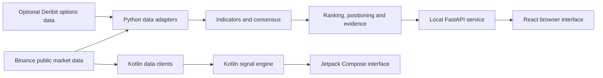

# Dive into Crypto

**DVCRY** (Dive into Crypto) scans Binance USDT-M perpetual futures and summarizes technical signals across 12 timeframes. It provides a ranked market view and a detailed breakdown of each symbol through a desktop browser interface and a native Android app.

The scanner combines 60 indicators with positioning and futures-market context. Its confidence values describe the engine's scoring rules; they are not probabilities of a profitable trade.

## Name and store listing

The project name is **Dive into Crypto**; the app displays **DVCRY** on Android and desktop.
The full marketing name is **DVCRY Deep Crypto Market Monitoring Tool**.
Google Play limits app titles to 30 characters, so the prepared listing uses
**DVCRY: Crypto Market Monitor** as its title and the full marketing name as its short description.
Store text is prepared under [`fastlane/metadata/android/en-US`](fastlane/metadata/android/en-US).
It is a publication draft, not a live Google Play listing. See the
[Google Play release roadmap](docs/google-play-release.md) for the remaining steps.

## What it does

- Calculates trend, momentum, volatility, volume, statistical and price-action indicators from market candles.
- Produces a weighted consensus with a direction, confidence score, risk assessment and individual indicator reasons.
- Ranks symbols across timeframes from one minute to one day, using a coarse scan followed by a more detailed candidate scan.
- Adds open-interest, funding, taker-flow, regime and multi-timeframe context to the technical read.
- Compares top-trader long/short positioning with price and filters conflicting candidates.
- Records desktop scan verdicts for later outcome grading, replay and evidence review.

Public market-data endpoints do not require exchange credentials. The application does not place orders or hold funds.

## Editions

| | Desktop | Android |
| --- | --- | --- |
| Interface | React UI served by a local Python service | Kotlin and Jetpack Compose |
| Runtime | Python 3.12+ and a browser | Android 8.0+ |
| Data access | Pinned [Crocodile](https://github.com/nazmiefearmutcu/Crocodile) dependency and direct public-data adapters | Public REST and WebSocket clients |
| Signal calculation | Python reference implementation | Kotlin implementation with reference-fixture tests |

## Architecture



The desktop backend separates data retrieval, indicator calculation, consensus, scanning and the HTTP/WebSocket API. It serves the committed UI bundle, so Node.js is only needed when developing the frontend. The Android app performs its calculations on the device; fixture tests compare its indicator outputs with the Python reference.

Most inputs come from Binance Futures, including candles, funding, open interest and long/short ratios. The desktop also has a separate optional Deribit adapter for BTC/ETH options and volatility metrics. A failed Deribit request does not block the main scan.

## Run the desktop edition

Requirements: **Python 3.12+**, **uv**, internet access to the market-data providers, and network access to GitHub for the pinned **[Crocodile](https://github.com/nazmiefearmutcu/Crocodile)** dependency (`uv sync` installs it from the commit pinned in `desktop/backend/pyproject.toml`; the unrelated `crocodile` package on PyPI is never used).

```bash
git clone https://github.com/nazmiefearmutcu/Dive-into-Crypto.git dive-into-crypto
cd dive-into-crypto/desktop/backend
uv sync
uv run dive-desktop
```

The service opens `http://127.0.0.1:8780`. Use `uv run dive-desktop --no-open` to start without opening a browser, or `--port 8888` to select another port.

For large universes, the desktop API supports asynchronous scans: `/api/scan?async=1` returns a scan identifier that can be followed through `/api/scan/progress`. See the [API reference](docs/api.md) for request parameters and response contracts.

## Android

Check [Releases](https://github.com/nazmiefearmutcu/Dive-into-Crypto/releases) for available Android artifacts. Build a debug APK with **JDK 17** and the **Android SDK** configured for the Gradle project:

```bash
cd android
./gradlew :app:assembleDebug
./gradlew :app:testDebugUnitTest
```

On Windows, use `gradlew.bat` instead of `./gradlew`. The app requires Android API 26 or later. Release signing and artifact packaging are described in the [packaging guide](docs/packaging.md).

## Data and practical limits

Scans depend on provider availability, geographic access, rate limits and the amount of history returned. A full-market scan can take minutes. Missing or stale data should be considered when reading a verdict.

The desktop UI keeps a separate, explicitly labeled demo mode for interface development. A failed live request does not automatically populate live values from the demo generator. Historical fixtures and synthetic test inputs are development material, not live market observations.

Consensus scores summarize indicator agreement. They do not establish predictive accuracy, and recorded outcomes require an appropriate evaluation period and sample size. This is a research and analysis tool, provided without a guarantee of accuracy or profitability.

## Development

```bash
# From desktop/backend: offline engine and parser tests
uv run pytest -q

# Opt-in tests against live providers
uv run pytest -m live -q
```

Frontend development requires Node.js 18+:

```bash
cd desktop/ui
npm ci
npm test
npm run build
```

See the [desktop guide](desktop/README.md), [Android guide](android/README.md), [testing guide](docs/testing.md), [contribution guide](CONTRIBUTING.md) for further details.

## License

[MIT](LICENSE).

Created By Aylin (Nazmi Efe Armutcu)
